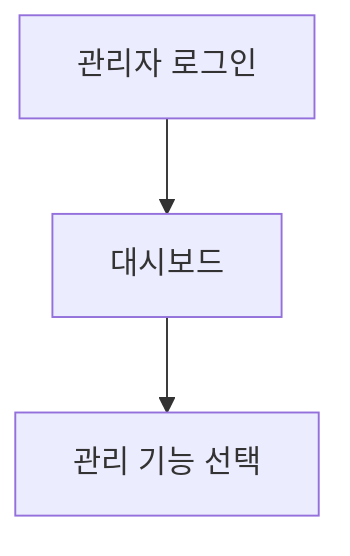

# 업무 분석 - 백오피스

> 일반 사용자가 아닌, 운영자(관리자)가 서비스를 통제하고 모니터링하는 기능 정의

## 1. 관리자 권한
| 역할 | 설명 | 가능한 작업 |
|---|---|---|
| | | |

## 2. 관리 기능 목록
| 구분 | 기능 | 설명 |
|---|---|---|
| 회원 관리 | | |
| 콘텐츠/데이터 관리 | | |
| 통계/모니터링 | | |

## 3. 관리자 프로세스

## 4. 예외 처리
| 상황 | 처리 방법 |
|---|---|
| | |
