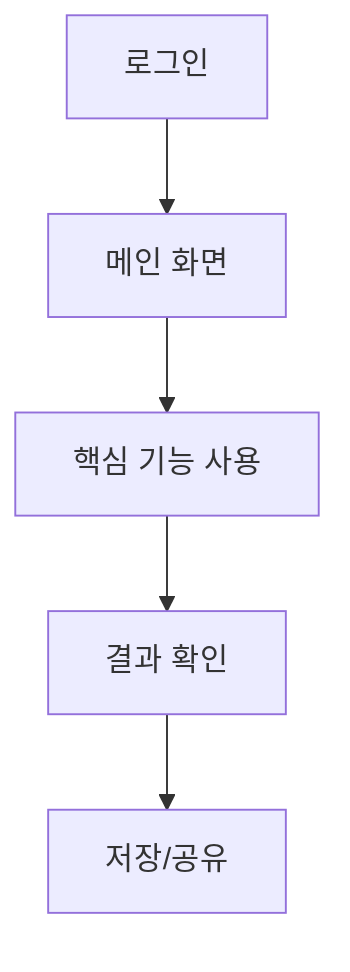

# 업무 분석 - 사용자

> 사용자가 서비스에 들어와서 목표를 달성하고 나갈 때까지의 핵심 여정(User Flow)

## 1. 메인 프로세스
로그인 → 메인 화면 → 핵심 기능 사용 → 결과 확인 → 저장/공유

## 2. 예외 프로세스
| 상황 | 처리 방법 | 사용자 안내 문구 |
|---|---|---|
| 로그인 실패 | | |
| 검색 결과 없음 | | |
| AI 응답 실패(Time-out) | | |

## 3. UI 상호작용
| 화면 | 동작 | 결과 (모달 / 페이지 이동 등) |
|---|---|---|
| | 버튼 클릭 | |
