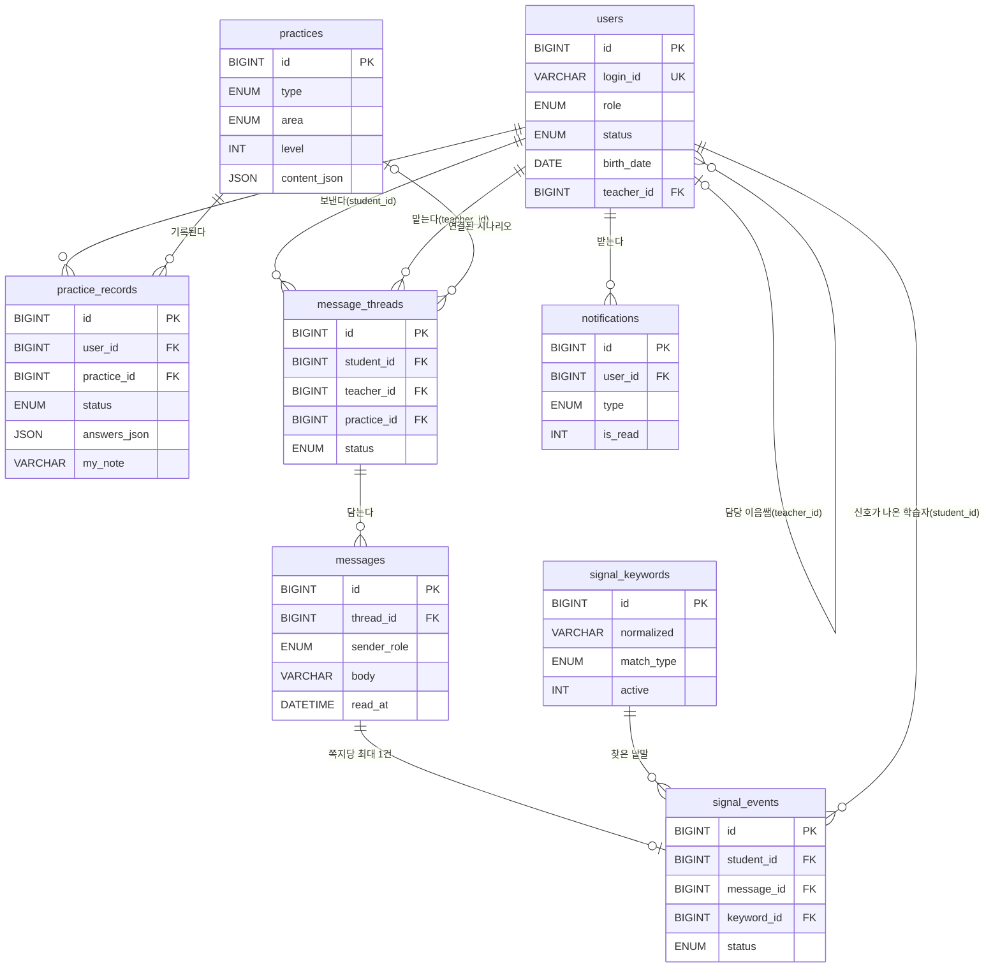

# DB 설계

> 데이터의 구조와 관계 정의

MySQL 8.0, InnoDB, utf8mb4(`utf8mb4_0900_ai_ci`). 테이블은 8개이고 스키마의 기준은 `db/` 폴더의 SQL 파일이다(V1 이후 변경은 V2, V3 … 새 파일로 쌓는다). 이 문서는 **V4(`users.birth_date` NOT NULL)까지 적용한 상태**를 적는다.

## 1. ERD (물리/논리)

`users`에서 학습 기록과 쪽지·신호 두 줄기가 갈라진다. `users.teacher_id`, `message_threads.student_id`·`teacher_id`는 모두 `users`를 가리킨다.

| 관계 | 설명 |
|---|---|
| users 1 : N practice_records | 학습자 한 명이 연습마다 기록 1행을 가진다 (`(user_id, practice_id)` 유일) |
| practices 1 : N practice_records | 연습 한 개에 학습자별 기록이 붙는다 |
| users 1 : N users (teacher_id) | 이음쌤 한 명이 여러 학습자를 맡는다 |
| users 1 : N message_threads | 학습자·이음쌤 각각 여러 쪽지 묶음을 가진다 |
| practices 1 : N message_threads | 시나리오에서 이어 보낸 쪽지가 연결된다 (선택) |
| message_threads 1 : N messages | 쪽지 묶음 안에 쪽지가 쌓인다 |
| messages 1 : 0..1 signal_events | 학습자 쪽지 1건당 신호 기록은 최대 1건이다 |
| signal_keywords 1 : N signal_events | 신호가 나온 낱말을 가리킨다 |
| users 1 : N notifications | 받는 사람(학습자·이음쌤)별 알림 |

## 2. 테이블 정의서

### 테이블명: users — 계정: 학습자·이음쌤 공통

| 컬럼명 | 데이터 타입 | Null 여부 | 제약 조건 | 기본값 | 설명 |
|---|---|---|---|---|---|
| id | BIGINT UNSIGNED | NOT NULL | PK | AUTO_INCREMENT | 계정 번호 (자동 증가) |
| login_id | VARCHAR(20) | NOT NULL | UNIQUE |  | 로그인 아이디. 영문·숫자 4~20자, 대소문자 구분 없이 유일 (소문자로 저장) |
| password_hash | VARCHAR(100) | NOT NULL |  |  | 비밀번호 BCrypt 해시 |
| role | ENUM('STUDENT','TEACHER') | NOT NULL |  | STUDENT | 학습자 STUDENT / 이음쌤 TEACHER |
| status | ENUM('ACTIVE','PENDING_GUARDIAN') | NOT NULL |  | ACTIVE | 계정 상태. 만 14세 미만은 보호자 확인 전까지 PENDING_GUARDIAN이라 로그인이 막힌다 |
| name | VARCHAR(30) | NOT NULL |  |  | 본명 |
| nickname | VARCHAR(20) | NOT NULL |  |  | 화면에 보이는 별명 (중복 허용) |
| birth_date | DATE | NOT NULL |  |  | 생년월일. 학습자·이음쌤 모두 필수 (V4에서 NOT NULL로 변경) |
| phone | VARCHAR(11) | NULL |  |  | 전화번호 (숫자 10~11자리) |
| email | VARCHAR(100) | NULL |  |  | 이메일 (선택) |
| school | VARCHAR(50) | NULL |  |  | 학교 (선택) |
| guardian_name | VARCHAR(30) | NULL |  |  | 보호자 이름 (만 14세 미만만) |
| guardian_relation | ENUM('PARENT','RELATIVE','FACILITY','OTHER') | NULL |  |  | 보호자 관계. 부모 PARENT, 친척 RELATIVE, 시설 FACILITY, 기타 OTHER |
| guardian_contact | VARCHAR(100) | NULL |  |  | 보호자 연락처 |
| teacher_id | BIGINT UNSIGNED | NULL | FK → users.id (ON DELETE SET NULL) |  | 담당 이음쌤(users.id). 첫 쪽지 때 자동 배정, 이음쌤 행이 지워지면 NULL |
| teacher_assigned_at | DATETIME | NULL |  |  | 담당 이음쌤이 배정된 시각 |
| terms_agreed_at | DATETIME | NOT NULL |  |  | 약관·개인정보 동의 시각 |
| last_login_at | DATETIME | NULL |  |  | 마지막 로그인 시각 (1년 미이용 삭제 기준) |
| created_at | DATETIME | NOT NULL |  | CURRENT_TIMESTAMP | 가입 시각 |

### 테이블명: practices — 연습 콘텐츠: 질문지 단위·시나리오·감정 읽기

| 컬럼명 | 데이터 타입 | Null 여부 | 제약 조건 | 기본값 | 설명 |
|---|---|---|---|---|---|
| id | BIGINT UNSIGNED | NOT NULL | PK | AUTO_INCREMENT | 연습 번호 (자동 증가) |
| type | ENUM('UNIT','SCENARIO','EMOTION') | NOT NULL |  |  | 연습 종류. UNIT 질문지 단위 / SCENARIO 시나리오 / EMOTION 감정 읽기 |
| area | ENUM('SAFETY','HELP','EMOTION') | NOT NULL |  |  | 저장값은 SAFETY / HELP(화면의 관계) / EMOTION(화면의 마음) |
| topic | VARCHAR(30) | NOT NULL |  |  | 목록에 보이는 소분류 이름 |
| level | TINYINT UNSIGNED | NOT NULL |  |  | 단계 (1 오팔, 2 아쿠아마린 …) |
| title | VARCHAR(60) | NOT NULL |  |  | 제목 |
| summary | VARCHAR(200) | NOT NULL |  |  | 한 줄 요약 |
| est_minutes | TINYINT UNSIGNED | NOT NULL |  | 10 | 예상 소요 시간(분) |
| content_json | JSON | NOT NULL |  |  | 연습 본문(문항·선택지·카드·장면 등). JSON 형식은 type마다 다르다 |
| sort_order | INT | NOT NULL |  | 0 | 같은 영역·단계 안의 정렬 순서 |
| published | TINYINT(1) | NOT NULL |  | 1 | 1이면 목록에 보인다 |
| created_at | DATETIME | NOT NULL |  | CURRENT_TIMESTAMP | 등록 시각 |

### 테이블명: practice_records — 학습 기록: 학습자 × 연습 1행

| 컬럼명 | 데이터 타입 | Null 여부 | 제약 조건 | 기본값 | 설명 |
|---|---|---|---|---|---|
| id | BIGINT UNSIGNED | NOT NULL | PK | AUTO_INCREMENT | 기록 번호 (자동 증가) |
| user_id | BIGINT UNSIGNED | NOT NULL |  |  | 학습자(users.id). 학습자가 지워지면 기록도 함께 지워진다 |
| practice_id | BIGINT UNSIGNED | NOT NULL | FK → practices.id |  | 연습(practices.id) |
| status | ENUM('IN_PROGRESS','DONE') | NOT NULL |  | IN_PROGRESS | 진행 상태. IN_PROGRESS 하는 중 / DONE 했어요 |
| answers_json | JSON | NOT NULL |  |  | 학습자가 고른 답. JSON 형식은 type마다 다르다 |
| my_note | VARCHAR(500) | NULL |  |  | "나에게 한 줄". 이음쌤용 API는 이 컬럼을 읽지 않는다 |
| started_at | DATETIME | NOT NULL |  | CURRENT_TIMESTAMP | 처음 시작한 시각 |
| updated_at | DATETIME | NOT NULL |  | CURRENT_TIMESTAMP (수정 시 자동 갱신) | 마지막으로 바뀐 시각 |
| completed_at | DATETIME | NULL |  |  | 마친 시각 |

### 테이블명: message_threads — 쪽지 묶음

| 컬럼명 | 데이터 타입 | Null 여부 | 제약 조건 | 기본값 | 설명 |
|---|---|---|---|---|---|
| id | BIGINT UNSIGNED | NOT NULL | PK | AUTO_INCREMENT | 쪽지 묶음 번호 (자동 증가) |
| student_id | BIGINT UNSIGNED | NOT NULL |  |  | 보낸 학습자(users.id) |
| teacher_id | BIGINT UNSIGNED | NOT NULL |  |  | 담당 이음쌤(users.id) |
| topic | ENUM('FRIEND','ONLINE','SCHOOL','HOME','ETC') | NOT NULL |  |  | 쪽지 주제. FRIEND 친구, ONLINE 온라인, SCHOOL 학교, HOME 집, ETC 기타 |
| practice_id | BIGINT UNSIGNED | NULL | FK → practices.id (ON DELETE SET NULL) |  | 연결된 시나리오(practices.id). 없으면 NULL, 연습이 지워지면 NULL |
| status | ENUM('WAITING','ANSWERED') | NOT NULL |  | WAITING | WAITING 답을 기다림 / ANSWERED 답함. 마지막으로 보낸 사람으로 정해진다 |
| created_at | DATETIME | NOT NULL |  | CURRENT_TIMESTAMP | 처음 보낸 시각 |
| last_message_at | DATETIME | NOT NULL |  | CURRENT_TIMESTAMP | 마지막 쪽지 시각 |

### 테이블명: messages — 쪽지 메시지

| 컬럼명 | 데이터 타입 | Null 여부 | 제약 조건 | 기본값 | 설명 |
|---|---|---|---|---|---|
| id | BIGINT UNSIGNED | NOT NULL | PK | AUTO_INCREMENT | 쪽지 번호 (자동 증가) |
| thread_id | BIGINT UNSIGNED | NOT NULL | FK → message_threads.id (ON DELETE CASCADE) |  | 쪽지 묶음(message_threads.id) |
| sender_role | ENUM('STUDENT','TEACHER') | NOT NULL |  |  | 보낸 사람. STUDENT 또는 TEACHER |
| body | VARCHAR(500) | NOT NULL |  |  | 쪽지 본문 (500자 이하) |
| created_at | DATETIME | NOT NULL |  | CURRENT_TIMESTAMP | 보낸 시각 |
| read_at | DATETIME | NULL |  |  | 받는 사람이 읽은 시각. NULL이면 안 읽음 |

### 테이블명: signal_keywords — 신호 낱말 사전 (시드)

| 컬럼명 | 데이터 타입 | Null 여부 | 제약 조건 | 기본값 | 설명 |
|---|---|---|---|---|---|
| id | BIGINT UNSIGNED | NOT NULL | PK | AUTO_INCREMENT | 낱말 번호 (자동 증가) |
| severity | ENUM('CRITICAL','WARNING') | NOT NULL |  |  | 치명 CRITICAL / 경고 WARNING. 정렬에만 쓴다 |
| category | VARCHAR(30) | NOT NULL |  |  | 분류 (자살 및 극단 선택 …) |
| headword | VARCHAR(30) | NOT NULL |  |  | 대표 단어 |
| expression | VARCHAR(50) | NOT NULL |  |  | 원래 표현 |
| normalized | VARCHAR(50) | NOT NULL |  |  | 소문자로 바꾸고 한글·영문·숫자만 남긴 값. 쪽지 본문과 비교하는 기준 |
| match_type | ENUM('WORD','CHOSEONG') | NOT NULL |  | WORD | WORD 낱말 / CHOSEONG 초성 |
| active | TINYINT(1) | NOT NULL |  | 1 | 1이면 신호 검사에 쓴다. 초성 표현은 0으로 보관 |

### 테이블명: signal_events — 신호 기록: 학습자 쪽지 1건당 최대 1행

| 컬럼명 | 데이터 타입 | Null 여부 | 제약 조건 | 기본값 | 설명 |
|---|---|---|---|---|---|
| id | BIGINT UNSIGNED | NOT NULL | PK | AUTO_INCREMENT | 신호 번호 (자동 증가) |
| student_id | BIGINT UNSIGNED | NOT NULL | FK → users.id (ON DELETE CASCADE) |  | 신호가 나온 학습자(users.id) |
| message_id | BIGINT UNSIGNED | NOT NULL | UNIQUE, FK → messages.id (ON DELETE CASCADE) |  | 신호가 나온 쪽지(messages.id). 학습자 쪽지 1건당 최대 1행 |
| keyword_id | BIGINT UNSIGNED | NOT NULL | FK → signal_keywords.id |  | 찾은 낱말(signal_keywords.id) |
| matched_text | VARCHAR(50) | NOT NULL |  |  | 쪽지에서 찾은 부분. 학습자에게는 보이지 않는다 |
| status | ENUM('OPEN','HANDLED') | NOT NULL |  | OPEN | OPEN 확인 필요 / HANDLED 대응함 |
| response_memo | VARCHAR(500) | NULL |  |  | 이음쌤의 대응 메모. 학습자에게 보이지 않는다 |
| handled_at | DATETIME | NULL |  |  | 대응한 시각 |
| created_at | DATETIME | NOT NULL |  | CURRENT_TIMESTAMP | 신호가 만들어진 시각 |

### 테이블명: notifications — 앱 안 알림

| 컬럼명 | 데이터 타입 | Null 여부 | 제약 조건 | 기본값 | 설명 |
|---|---|---|---|---|---|
| id | BIGINT UNSIGNED | NOT NULL | PK | AUTO_INCREMENT | 알림 번호 (자동 증가) |
| user_id | BIGINT UNSIGNED | NOT NULL | FK → users.id (ON DELETE CASCADE) |  | 받는 사람(users.id). 학습자 또는 이음쌤 |
| type | ENUM('NOTE_RECEIVED','SIGNAL_FLAGGED','LEARNER_ASSIGNED','REPLY_ARRIVED','NOTE_READ','TEACHER_ASSIGNED') | NOT NULL |  |  | 알림 종류 6가지. NOTE_RECEIVED, SIGNAL_FLAGGED, LEARNER_ASSIGNED, REPLY_ARRIVED, NOTE_READ, TEACHER_ASSIGNED |
| title | VARCHAR(80) | NOT NULL |  |  | 알림 제목. 서버가 정해 둔 문구만 쓴다 (쪽지 본문·찾은 낱말 금지) |
| body | VARCHAR(200) | NOT NULL |  |  | 알림 내용. 서버가 정해 둔 문구만 쓴다 |
| link_type | ENUM('THREAD','SIGNAL','PROFILE','STUDENT') | NULL |  |  | 눌렀을 때 이동할 곳. THREAD, SIGNAL, PROFILE, STUDENT |
| link_id | BIGINT UNSIGNED | NULL |  |  | 이동할 대상의 번호 |
| is_read | TINYINT(1) | NOT NULL |  | 0 | 0 안 읽음 / 1 읽음 |
| read_at | DATETIME | NULL |  |  | 읽은 시각 |
| created_at | DATETIME | NOT NULL |  | CURRENT_TIMESTAMP | 알림이 만들어진 시각 |

## 3. 데이터 이력 관리 정책
- 삭제 방식: **Hard Delete** (삭제 여부 플래그 컬럼을 두지 않는다)
- 선택 이유:
  - 화면이 "탈퇴하면 기록을 바로 지워요", "마지막 이용 뒤 1년이 지나면 지워요"라고 약속한다. 플래그만 바꾸면 이 약속을 지킬 수 없다.
  - 학습 기록·쪽지·신호·알림은 모두 `users`에 딸려 있어서, `users` 행을 지우면 `ON DELETE CASCADE`로 함께 사라진다. 지워야 하는 곳이 한 곳이다.
  - 신호 기록과 쪽지 본문까지 지우므로 개인정보 보유 기간 안내와 맞다.
- 예외: `practices`(연습 콘텐츠)는 삭제하지 않고 `published = 0`으로 목록에서 숨긴다. 수정·삭제 API가 없고 시드 SQL로만 등록한다.
- 이음쌤 행이 지워져도 `users.teacher_id`는 NULL이 되고(ON DELETE SET NULL), 쪽지 묶음이 남아 있는 이음쌤은 `message_threads.teacher_id`에 삭제 규칙이 없어서 먼저 지울 수 없다. 이음쌤 삭제 전에 담당을 이관한다.

## 4. 인덱스와 유니크 키

| 테이블 | 이름 | 컬럼 | 쓰는 곳 |
|---|---|---|---|
| users | uq_users_login_id (UNIQUE) | login_id | 로그인 아이디 중복 방지 (01·02) |
| users | ix_users_teacher | teacher_id | 이음쌤의 담당 학습자 목록 (17) |
| practices | ix_practices_list | published, area, level, sort_order | 연습 목록 정렬·필터 (08) |
| practice_records | uq_records_user_practice (UNIQUE) | user_id, practice_id | 학습자×연습당 기록 1행 (10) |
| practice_records | ix_records_user_status | user_id, status, updated_at | 하는 중·마친 기록 조회 (07·11) |
| message_threads | ix_threads_student | student_id, last_message_at | 학습자 쪽지함 (13) |
| message_threads | ix_threads_teacher | teacher_id, status, last_message_at | 이음쌤 쪽지 목록 (19) |
| messages | ix_messages_thread | thread_id, id | 쪽지 묶음 안 순서 (14) |
| messages | ix_messages_unread | thread_id, sender_role, read_at | 안 읽음 수 계산 (07·13·16) |
| signal_keywords | uq_keywords (UNIQUE) | match_type, normalized | 같은 낱말 중복 방지, 신호 검사 (12·15) |
| signal_events | uq_signal_message (UNIQUE) | message_id | 쪽지당 신호 최대 1건 |
| signal_events | ix_signal_status | status, created_at | 확인 필요 신호 목록 (16·20) |
| signal_events | ix_signal_student | student_id | 학습자별 신호 (17) |
| notifications | ix_notifications_user | user_id, is_read, created_at | 받는 사람별 안 읽음 알림 (22) |

## 5. 설계 결정 (대안 비교)

원래 설계(API 150개·테이블 56개)를 1주·3인 일정에 맞춰 **API 24개·테이블 8개**로 줄였다. 줄인 기능은 버리지 않고 보관 원본(역설계 초안)에 남겨 두었다.

| 결정 | 선택한 방식 | 버린 대안 | 이유 |
|---|---|---|---|
| 연습 콘텐츠 | `practices` 한 테이블, 문항·선택지·카드는 `content_json`에 넣는다 | 문항·선택지·학습 카드 테이블을 따로 둔다 | 콘텐츠를 시드 SQL로만 등록하고 수정 API가 없다. 테이블을 쪼개면 조인과 시드가 늘기만 한다 |
| 학습 결과 | `practice_records` 한 테이블, 학습자×연습 1행, 다시 하면 덮어쓴다 | 응답 상세 테이블, 콘텐츠 버전별 기록 | 화면이 보여 주는 것은 마지막 결과와 그때·지금 비교뿐이다 |
| 점수 | 만들지 않는다 | 점수·순위 컬럼 | 화면이 "점수·순위·맞고 틀림을 남기지 않는다"고 약속한다 |
| 나에게 한 줄 | `practice_records.my_note` 컬럼, 이음쌤용 쿼리가 읽지 않는다 | 별도 노트 테이블, 노트 암호화 | 이음쌤에게 보이지 않는 규칙을 쿼리 수준에서 지킨다 |
| 신호 감지 | 쪽지를 저장하는 같은 트랜잭션에서 낱말 사전과 비교해 `signal_events`에 기록한다 | outbox 같은 별도 작업 테이블과 배치 | 쪽지 저장과 신호 기록이 함께 성공하거나 실패해야 하고, 작업 테이블을 두면 관리할 것이 는다 |
| 이음쌤 배정 | 첫 쪽지 때 학습자 수가 가장 적은 활성 이음쌤을 `users.teacher_id`에 기록한다 | 배정 화면·배정 테이블 | 배정 이력이 필요 없다. 이관은 화면에서 신청 알림만 보여 주기로 했다 |
| 계정 | `users` 한 테이블에 `role`로 학습자·이음쌤을 함께 둔다 | 학습자·이음쌤·보호자 테이블 분리 | 로그인과 알림이 공통이고, 보호자는 컬럼 3개로 충분하다 |
| 알림 | `notifications` 테이블에 받는 사람별로 저장한다 | 쪽지·신호에서 그때그때 계산 | 읽음 상태가 필요하고, 알림 제목·본문은 서버가 정한 고정 문구만 써서 쪽지 내용이 새지 않는다 |
| 날짜 입력 | `birth_date`는 학습자·이음쌤 모두 NOT NULL (V4) | 이음쌤은 NULL 허용 | 가입 화면과 API가 이음쌤도 생년월일을 필수로 받는다. DB도 같은 기준으로 맞췄다 |

## 6. 시드와 마이그레이션 이력

SQL 파일은 `db/`에 있고 번호 순서대로 실행한다. 이미 실행한 파일은 고치지 않고, 바꿀 때는 새 번호 파일을 만든다.

| 파일 | 내용 | 비고 |
|---|---|---|
| `V1__init.sql` | 테이블 8개 DDL, 인덱스, 외래키 | |
| `V2__seed_signal_keywords.sql` | 신호 낱말 사전 107행 (낱말 95 active, 초성 12 inactive) | 원본 CSV 129행에서 공백·특수문자를 빼고 중복 제거 |
| `V3__seed_practices.sql` | 연습 콘텐츠 3건 (질문지 1, 시나리오 1, 감정 읽기 1) | 나머지 연습은 본문이 정해지면 추가 |
| `V4__users_birth_date_not_null.sql` | `users.birth_date`를 NOT NULL로 변경 | 이음쌤도 생년월일 필수. NULL인 이음쌤은 임시 값으로 채움 |
| `ops.sql` | 운영 SQL 4개 | 이음쌤 등록, 보호자 확인(PENDING_GUARDIAN → ACTIVE), 비밀번호 초기화, 1년 미이용 학습자 삭제 |

이음쌤 계정(비밀번호 해시 포함)은 Git에 올리지 않는다. 레포가 Public이기 때문이다. 필요하면 가입 API(01번)에서 role=TEACHER로 가입하거나, ops.sql의 (1)에 본인이 만든 BCrypt 해시를 넣어 DB에 직접 등록한다.
