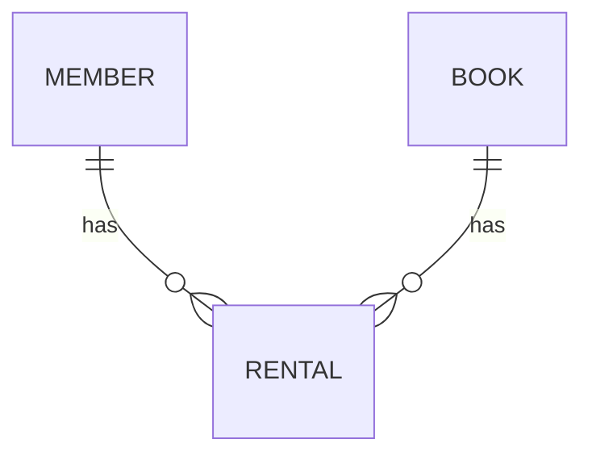

# DB 설계

> 데이터의 구조와 관계 정의

## 1. ERD (물리/논리)
테이블 간 관계(1:N, N:M), PK/FK, 인덱스 위치

## 2. 테이블 정의서

### 테이블명: (예: member)
| 컬럼명 | 데이터 타입 | Null 여부 | 제약 조건 | 기본값 | 설명 |
|---|---|---|---|---|---|
| id | | NOT NULL | PK | | |

## 3. 데이터 이력 관리 정책
- 삭제 방식: Hard Delete / Soft Delete (삭제 여부 플래그) 중 선택
- 선택 이유:
